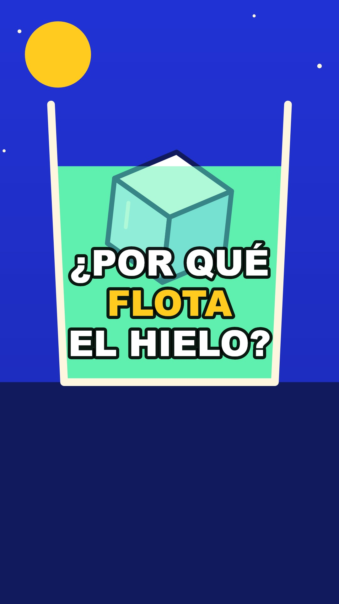

# mente-videos

Una skill para Claude Code que convierte una idea en un vídeo vertical explicativo, dibujado con código, con voz,
subtítulos, efectos y portada.

Es un punto de partida: trae el motor y un método básico, pero no un estilo. El estilo lo pones tú. La skill te pregunta
cómo quieres que sean tus vídeos, recuerda lo que apruebas y guarda tus dibujos en tu propio kit.

[](mente-videos/ejemplos/hielo/final/video.mp4)

## Instalación

Necesitas una cuenta de Claude con acceso a Claude Code.

1. Descarga este repositorio con **Code > Download ZIP** y descomprímelo.
2. Abre la carpeta en Claude Code.
3. Escribe `instálame`.

Claude instala lo que falte y te pregunta dónde guardar tus vídeos, qué voz usar, en qué idioma y con qué estilo. También
crea tu carpeta de assets. Después abre una conversación nueva y escribe:

```
/mente-videos un vídeo sobre por qué el hielo flota
```

Abre `BIENVENIDA.html` en tu navegador para ver la guía completa.

## Voz

- **ElevenLabs (recomendada):** suena natural y da el tiempo exacto de cada palabra. Usa tu cuenta y tu saldo. Claude abre
  una web en tu ordenador para pegar tu clave, que se guarda en `~/.mente-videos/.env`.
- **Local:** gratis y sin cuenta, pero suena robótica y sus tiempos son aproximados.

## Tu carpeta de assets

Pon aquí lo que quieras usar en tus vídeos:

- `letras`: archivos `.ttf` u `.otf`;
- `efectos`: sonidos cortos;
- `audios`: música o audios largos;
- `texturas`: imágenes.

Usa solo material que tengas permiso para usar.

## Dónde queda cada cosa

- Tus proyectos y borradores: tu carpeta de revisión.
- Tus vídeos terminados: tu carpeta de finales.
- Tu estilo, ajustes, clave y kit: `~/.mente-videos/`. Esta carpeta no forma parte del repositorio.

## El repositorio

| Ruta | Contenido |
|---|---|
| `mente-videos/` | La skill: instrucciones, motor, plantilla y ejemplo |
| `mente-videos/ejemplos/hielo/` | Un vídeo completo, con todo lo necesario para ver cómo se construye |
| `CLAUDE.md` | Las instrucciones que sigue Claude al escribir «instálame» |
| `instalar.mjs` | Copia la skill a `~/.claude/skills/` |
| `BIENVENIDA.html` | La guía de inicio |
| `pagina/` | El código fuente de la guía |

Para cambiar el diseño de la guía, edita `pagina/fuente.html` y ejecuta `npm install` y `npm run construir` dentro de
`pagina/`. Tu nombre y tus cuentas se pueden cambiar directamente en el bloque `MARCA`.

## Ideas para mejorarla

- Dibuja tus personajes y objetos en `~/.mente-videos/kit.mjs`.
- Llena tu carpeta de assets con tus letras, sonidos y texturas.
- Crea plantillas para tus formatos.
- Mejora el motor: transiciones, estilos de subtítulos, más revisiones automáticas.

## Licencia

MIT. Consulta `LICENSE`.

`BIENVENIDA.html` incluye las letras Bricolage Grotesque y Atkinson Hyperlegible (SIL Open Font License 1.1) y los iconos
de redes de Simple Icons (CC0). Las marcas de esas redes pertenecen a sus dueños.
